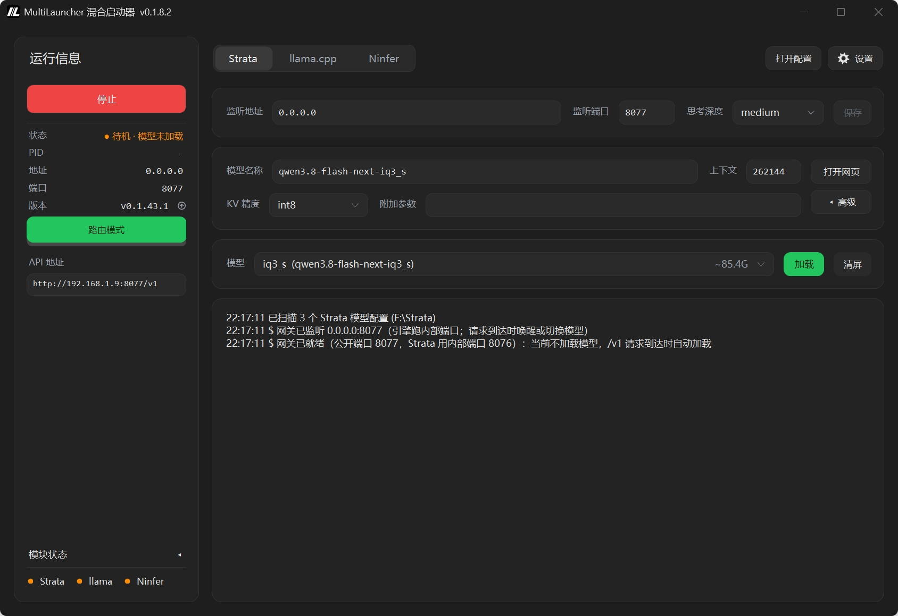

# MultiLauncher 混合启动器 · 使用说明书

适用版本：**v0.1.8.8** ｜ 平台：Windows 10 / 11（x64）。文中出现的路径、模型名、端口、密钥、版本号均为**示例或占位符**，请以本机实际值为准。

---

## 0. 一分钟认识它

*主界面示意图：左栏「运行信息」+ 三个模块页签 + 参数卡 + 日志。界面细节以你实际运行的版本为准。*

MultiLauncher 是一个**本地大模型启动器**。原本要在命令行里敲的一堆命令——挑模型、调参数、启动服务、看日志、查更新——现在都在一个窗口里点几下就行。

它可以同时管**三个引擎**，可以只开一个，也可以都开：

| 引擎 | 是什么 | 界面上叫什么 |
| --- | --- | --- |
| Strata | 自带的 Strata 推理引擎 | Strata |
| llama.cpp | 大家常用的 `llama-server` | llama.cpp |
| Ninfer | 另一套推理引擎，可在两种环境下跑：WSL（跑在虚拟机里）与 WIN（直接跑在本机） | Ninfer |

三个引擎**互不打扰**，各用各的页面、各存各的配置、各走各的更新。关掉某一个，它在界面上就**彻底不见了**——不去找模型、不去探测、也不启动任何程序。

---

## 1. 它能帮你做什么

- **挑模型**：从下拉里选一个，上面的参数会自动换成**这个模型自己那一套**。
- **调参数**：上下文长度、KV 精度、投机解码、视觉、显卡……改完点「保存」就存下来了。
- **启动服务**：点左边「启动」，引擎起来后日志里会出现一行 `已就绪`，状态灯变成绿色。
- **看日志**：引擎的输出都进日志框，按引擎分开显示。
- **查更新 / 退回旧版**：一键检查新版本、下载、升级；升级前会自动备份，随时能退回去。
- **当一个统一的入口**（路由模式）：让别的程序只连一个端口，启动器根据请求里写的模型名，自动把对应的模型唤醒。

**它不负责什么**：

- 不负责下载几十 GB 的模型文件（装模型请用官方的 SETUP，启动器只管「配置新模型」这一步）。
- 不修改引擎本身的源代码与配置模板（「升级」那一项除外——它会把源码换成新版本）。
- 不做官方标注为实验性的功能。

---

## 2. 装在哪、怎么跑起来

### 2.1 目录长什么样

启动器是**绿色的**——整个文件夹删掉就能重来，所有设置和配置都放在自己这一层里：

| 路径 | 说明 |
| --- | --- |
| `MultiLauncher.exe` | 启动器本体（单个文件，旁边没有其它调试文件） |
| `MultiLauncher.ini` | 启动器自己的设置 |
| `logs/` | 日志文件（勾选「写入日志文件」之后才会有） |
| `data/config/llama/llama_models.ini` | llama.cpp 的配置 |
| `data/config/ninfer/ninfer_models.ini` | Ninfer 的配置 |
| `data/config/strata/strata_models.ini` | Strata 的配置 |
| `data/backup/llama/` | llama.cpp 的配置备份 |
| `data/backup/ninfer/` | Ninfer 的配置备份 |
| `data/backup/ninfer-exe/` | Ninfer 的引擎程序备份（程序文件单独放一处） |
| `data/backup/strata/` | Strata 的配置备份 |
| `data/tmp/` | 临时目录：解压更新包、跑自检的副本都放这儿；超过 3 天的残留会自动清理 |

Strata 还有它**自己的数据目录**（模型、编译出来的东西等），那个目录**启动器只读**，不会往里写任何东西。

### 2.2 启动与退出

- **双击 exe** 就能用，不用安装。
- 点右上角的 **✕ 只是缩小到托盘**（这个行为可以在设置里关掉）；要真正退出，走**托盘图标右键菜单 →「退出」**。
- 勾了「随系统启动」，登录 Windows 后它就会自动运行；再勾上「启动时隐藏到托盘」，就一直待在后台，不弹窗。

---

## 3. 界面总览

主窗口分四块：**左边一栏**、**顶部页头**、**中间主区**、**最下面状态栏**。

### 3.1 左边一栏（当前引擎的运行情况）

从上往下：

| 位置 | 内容 |
| --- | --- |
| 启动/停止按钮 | 文字跟着当前状态变：服务在跑 → 「停止」；端口上的服务是启动器之外启动的 → 「停止」（会先问你一句）；只剩统一入口在跑 → 「停止网关」；什么都没跑 → 「启动」 |
| 运行状态 | 一盏状态灯 + 一行文字，还有一行**版本**（行末有个小小的更新按钮） |
| 模式条 | 点一下在**路由模式 / 单体模型**之间切换（两个引擎各记各的） |
| API 地址 | 给别的程序用的地址：`http://<地址>:<端口>/v1` |
| 引擎状态 | 一直显示**所有开着的引擎**的灯：灰=没在跑 / 绿=已就绪 / 橙=在跑但闲着 / 红=出问题了 |

### 3.2 顶部页头与中间主区

页头是几个**并排的按钮**：每个开着的引擎占一格（Strata / llama.cpp / Ninfer）。**点一下就换到那一页；换页只是换个视角，不会动服务。**

每一页有三张卡：

- **参数卡**
  - 第一行：`监听地址 ｜ 监听端口 ｜ 思考深度 ｜ 保存`
  - 第二行：`模型名称 ｜ 上下文 ／ KV 精度 ｜ 附加参数`
  - 右边一排按钮：「打开网页」「高级」（展开后内容跟着当前引擎变）
- **模型卡**：模型下拉框 + 加载/卸载按钮（下拉里带绿色「已加载」标记，以及灰色的占用大小估算）
- **日志卡**：这个引擎的日志；「清屏」只清当前这一页显示的内容

### 3.3 最下面的状态栏

服务在跑的时候出现，一共能显示**九项**数字，每一项都可以单独勾选：

`预填充 ｜ 解码 ｜ MTP 接受率 ｜ 队列 ｜ 缓存命中 ｜ 输入 ｜ 输出 ｜ 显存 ｜ 温度`

- **平均值 vs 当前值**：只有「预填充」和「解码」这两项有「平均」可选，而且**和「实时」是分开的**——只勾平均，就只显示平均值。
- **取不到数的项显示一个短横 `-`**（不带单位）。
- **顺序可以拖**：在设置页里按住某一项横向拖动，拖出来的先后就是下面那一条的先后。
- **显存 / 温度是整张显卡的值**（不是某个进程的），三个页面显示的是同一个数。

---

## 4. 三个引擎怎么用

### 4.0 界面上只放了常用参数，没放的照样能用

界面上只摆了常用的那些参数。引擎自己升级后多出来的新参数，界面不一定马上就有——但这不影响你使用：**每个引擎的参数最终都存在它自己的配置文件里**，直接改那份文件就行，引擎下次启动读的就是它。

| 引擎 | 改哪里 | 什么时候生效 |
| --- | --- | --- |
| Strata | `data/config/strata/strata_models.ini` 里对应模型的 `Args1..ArgsN` 行，或一行一块的 `{参数名 = 值}`（**你自己加的新参数**，见 §4.1）；或 `<Strata 目录>/strata-<模型名>.json`（这是模板，启动器只读不写） | 「停止」再「启动」 |
| llama.cpp | `data/config/llama/llama_models.ini`（和界面上点「保存」写的是同一份） | 「停止」再「启动」；模型行的「加载」也会让引擎重新读一遍 |
| Ninfer | `data/config/ninfer/ninfer_models.ini`（一段就是一个模型，段里一行一个参数） | 同上 |

两点提醒：临时试一两个参数，用第二行的「附加参数」最快；要长期生效就写进配置文件，那份才是引擎读的。Strata 那份模板是 SETUP 生成的，**手动改过之后下次再跑 SETUP 会被覆盖**——想长期留住，就写进 `strata_models.ini` 里该模型的 `Args1..ArgsN` 或 `{参数名 = 值}`。

### 4.1 Strata

- **配置存在哪**：`data/config/strata/strata_models.ini`，**一个模型一段**（段名就是模型名）。界面上改的参数就是那 16 项（点「保存」写进去的就是它）。`<Strata 目录>/strata-<模型名>.json` 是**模板**（启动器只读，由 SETUP 生成）。
- **自己加参数**：同一段里的 `Args1 =`、`Args2 =`……——如果上游新加了启动器还不认识的开关，就一行一个词写进去（`Args1 = --某个开关`、`Args2 = 值`）。一行一个的好处是值里带空格也不会串。启动器只读这几行、写回时原样保留，SETUP 也碰不到。启动器自己管的那几项（上下文 / KV / 投机 / 视觉……）以界面为准，写在这里会被忽略，启动日志里会点明。启动日志还会说两件事：这一项**模板里没有**（多半是名字写错了，引擎会因此起不来）、以及这一项**把模板里的值改成了什么**（原来 → 现在）。
- **一行的写法**：`键 = 值`，等号两边各留一个空格（和 llama.cpp、Ninfer 两份配置一个样）；值为空时写成 `LayerSplit =`（后面不再留空格）。你手写的行启动器一个字符都不改；被界面「保存」重写过的那些会自动排成这个样子。已有的文件在 2026-10-25 已经整份转过一次（改之前备份在 `data/backup/strata/`），所以现在打开看到的应该都是新样子。
- **花括号写法**：同一段里也可以一行写一块 `{参数名 = 值}`，一块就是一组参数——比如 `{pool-workers = 15}` 单独一行，另一个参数再起一行。**值里带空格也不会串**（`=` 后面整段都算值），读起来比 `Args1=` / `Args2=` 一行一个词更清楚，参数一多尤其明显。两种写法可以混着用，启动器都认。**只认一行一块**：如果 `{` 单起一行、`}` 另起一行那样跨行写，启动器不认，启动日志会明确提醒（不会装没看见，也不会猜）。启动器只读这些行、写回时原样保留，SETUP 也碰不到；启动器接管的参数（上下文 / KV / 投机 / 视觉……）写进花括号同样会被忽略并点明，界面仍然是唯一准的。注意**写法统一不等于含义统一**：那 16 项是启动器真正懂的开关（有默认值、有校验、会参与推算），花括号里的只是启动器不懂、原样转给引擎的，它只搬不改。
- **每次启动生成的文件**：`data/config/strata/run/<模型名>.json` 是**临时生成的**——每次启动前按「模板 + 你那组 + 你手加的」重新生成，旁边的 `<模型名>.shared-settings.json` 是引擎的聊天设置。**在这两份上改，下次启动就没了。**
- **想长期改**：改 `strata_models.ini` 里那一段（或者在界面上改完点「保存」）；要加启动器不认识的新参数，就加 `ArgsN` 行，或者写一行 `{参数名 = 值}`。
- **「打开配置」按钮**：打开 `data/config/strata/strata_models.ini` 这一份文件（和 llama.cpp、Ninfer 一个样）。临时生成的那两份在 `run\` 子目录里，不用管。启动器自己的 `MultiLauncher.ini` 在设置页「通用 → 路径」那一行。
- **手改之后怎么生效**：改完点「停止」再「启动」就会重新读这一份，不用重启启动器；但**别在改完、还没重新启动的这段时间里点「保存」**（那会把界面上那份旧值写回去）。
- **上下文调得超过模型训练长度**时，启动器会自动补上 `--rope-scaling yarn` 和 `--rope-scale <倍数>`，并顺手打开 `fit_max_tokens`（提示很长、输出上限又大时截断，而不是报错 400）。这两个不是单独的开关，是「上下文」这个数变大的连带结果。

### 4.2 llama.cpp

- **配置存在哪**：`data/config/llama/llama_models.ini`。**界面上点「保存」写的就是它、引擎读的也是它**——同一份文件，不存在「两份要对齐」的问题。
- **一个文件里有多段**：每个 `[模型名]` 段就是一个模型。**留空 = 从这个段里删掉这一项 = 回到上一层的值**（读取顺序：本段 → `[*]` / 文件头 → 引擎默认）。
- **模型行的按钮**：这一页**只要有东西加载着就一直显示「卸载」**，点它卸掉的是**实际正在加载的那一个**（不用先把下拉框指过去）；一个都没加载时才显示「加载」。换模型 = 先卸载再加载。
- **单体模式**下按钮变成「重载」= 按界面上当前的参数重新加载。
- **关于速度的提醒**：`parallel` 这一项启动器不替你做主。不写的时候引擎自己决定 = 4 个槽位 + 统一 KV，**本机实测比 `parallel = 1` 慢很多**。想要那个速度，就在段里（或 `[*]` 里）写 `parallel = 1`，或者在第二行「附加参数」里填 `--parallel 1`。启动器只在日志里提醒一句，**不会替你改配置文件**。

### 4.3 Ninfer

**一个引擎、两种运行环境**：WSL（跑在虚拟机里）和 WIN（直接跑本机的程序）。界面上就叫 WSL / WIN。

- **第一张卡左边那块方块 = 选运行环境**：当前那个在中间，底下露一条边提示「还有一个」，点一下切换。
- **用哪一边，由段里写的 `backend` 决定**：客户端请求的是 WIN 那一个，就走 WIN 那条路，方块、下拉框和参数格子一起切过去。
- **只有「按需唤醒」这一种**：启动器占着**对外的端口**，引擎绑**内部端口**；没请求就把服务停掉、把显存还给系统，下次有请求自动起来（本机约 9 秒 / WSL 约 15 秒）。所以这一页**没有模式条**。
- **左边的「启动」= 只把统一入口立起来**，不加载模型、不占显存。模型有两个入口：① 客户端发出第一个 `/v1` 请求；② 第三张卡的「加载」。
- **配置存在哪**：`data/config/ninfer/ninfer_models.ini`。一段就是一个模型，段名就是对外使用的模型名；段里有 `backend` / `file` 两项 + **其余一行一项**。**开关要「关」= 把那一项删掉，不会写成 `= false`。**
- **启动器不新建段、不改段名、不删段**——要加新模型，自己往文件里补一段。
- **值填错了不会拦着你输入，但会在启动服务前拒绝并说清原因**（例如：共享前缀上限必须为 0、WIN 的上下文必须大于设备池、swift 的模型不能配逐行的 KV、分块预填充不能大于 4096、主机缓存不能大于 16384）。
- **WSL 这一边默认是关着的**：开着它每次启动都要扫一遍虚拟机（会把虚拟机拉起来）。要用就在设置页里打开，并核对发行版名称、虚拟机里的模型目录和引擎路径。
- **这个引擎没有自带的网页界面**，所以这一页不放「打开网页」。

---

## 5. 两种启动方式

点一下左边那根模式条就能切换（**两个引擎各记各的**）：

| | 路由模式 | 单体模型 |
| --- | --- | --- |
| 点「启动」会做什么 | **只把统一入口立起来**，不加载模型 | 启动服务**并**加载选中的模型 |
| 谁在用对外的端口 | 启动器自己的统一入口 | 引擎自己 |
| 模型什么时候加载 | 第一个推理请求进来时，按请求里写的模型名 | 点启动的当下 |
| 同时驻留几个模型 | 一个（换模型 = 停掉旧的、起新的） | 一个 |

**路由模式下**：

- `GET /v1/models` 由启动器自己回答（列出所有已就绪的模型），**不会加载任何一个模型**。
- **只有真正的推理请求才会唤醒模型**（`/v1/chat/completions`、`/v1/completions`、`/v1/messages`、`/v1/embeddings`、`/v1/rerank`、`/v1/responses`）。`/metrics`、`/health` 这类路径**不会唤醒**——免得监控程序定时来问，把刚闲着停掉的模型又吵醒。
- 请求里的 `model` 对不上任何一个配置 → 返回 **400**，并列出可用的模型名。
- **唤醒时用的是「那个模型自己存下的那份参数」，不是界面上此刻显示的值。** 换句话说：**想让远端用上新参数，唯一要做的就是点「保存」。** 你自己点「启动」或「加载」，用的仍然是界面上的值。
- 引擎起不来时，提示分两种情况：**你点按钮** → 当场弹窗说清原因；**请求从外面进来** → 只写一行日志，并把同一句话原样回给客户端（503 / 504）。

---

## 6. 设置页

设置窗分几块：**通用 / 每个开着的引擎各一节 / 关于**（关掉的引擎，那一节整节不出现）。

**什么时候生效**：所有改动都要点「保存」才生效并写进文件；点「取消」则全部丢弃。

### 6.1 通用

| 分组 | 里面有什么 |
| --- | --- |
| 引擎 | 三个引擎的开关（**至少要开一个**；关掉之前要先停掉它的服务，保存时会拦下来） |
| 启动行为 | 随系统启动 / 启动时隐藏到托盘 / **自动启动服务 ·（每个引擎一个）** / 就绪后打开网页 |
| 接口 | **API Key**（三个引擎共用一把） |
| 显存 | **显存互斥处理**（进入队列 / 返回报错）、**排队等显存上限(秒)** |
| 关闭行为 | 关闭到托盘 / 退出时停止服务 |
| 日志 | 写入日志文件 / 调试信息过滤 / 显示状态栏（还有一排可以拖动排序的子选项） |
| 路径 | **配置文件**（`MultiLauncher.ini`）和 **程序目录**，各有一个「打开」直接打开（这一组在页面最上面） |

**API Key**：设置之后，别的程序调用时要带上 `Authorization: Bearer <key>`（Ninfer 也认 `x-api-key`）；留空就是不做验证。启动器自己去探活时也会带上它，所以设了不会影响状态灯和就绪判断。已知的一点：路由模式下，启动器**自己回答**的 `GET /v1/models` 不校验它（只有真正推理的那些路径受保护）。

**显存互斥处理**：同一张显卡上，任何时候只允许有一个模型被读进显存。

- **进入队列** = 请求进来时先排队等显存，等到超时就返回 504，并说清前面是谁占着。
- **返回报错** = 立刻返回 503，并说清是谁占着。
- 你自己点「启动」/「加载」那一路**永远是当场拒绝并说清是谁**，和这里选的无关。
- 启动器**不会替谁把那个停掉**——要腾地方，得用「卸载」/「停止」，或者等它自己空闲停服。

### 6.2 各引擎那一节

每一节的「维护」组都是同一个样子：**更新源 → 版本 → 退回旧版 → 各自独有**。

| 引擎 | 这一节里有什么 |
| --- | --- |
| Strata | 路径（Strata 目录 / 模型配置目录）、运行（内部端口 / 空闲停服）、维护（更新源 / 版本 / 退回备份 / 配置新模型）、内置的 llama.cpp |
| llama.cpp | 路径（llama.cpp 目录 / 模型配置 / 模型目录）、运行（同时加载上限 / 空闲停服）、维护（更新源 / 版本 / 改动前自动备份） |
| Ninfer | 共用（内部端口 / 模型配置）、WSL 那一侧（启用 / 发行版 / 模型目录 / 引擎程序 / 空闲停服）、WIN 那一侧（启用 / 引擎目录 / 空闲停服）、维护（两条路各自的更新源、版本、退回、备份） |

### 6.3 关于

`版本 / 作者 / 更新源 / 更新 / 帮助` —— 这一页只讲**启动器自己**。（配置文件 / 程序目录那两个「打开」在「通用 → 路径」，也就是页面最上面。）

「更新源」是**启动器自己**的更新地址（可以改，留空或填错就用默认那个）；「更新」那一行显示检查结果，右边的「更新…」会打开启动器自己的更新窗。见 §7.1。

---

## 7. 更新与退回旧版

**一个引擎一个窗口**（Ninfer 是两种环境各一个窗），从设置页那一节的「更新…」或托盘里对应那一组的「检查更新」进入。**窗口一打开就自动查一次**，平时不会发请求。

窗口里三行，每行末尾各有一个按钮：`版本那一行末尾 跳过/取消跳过`、`检查更新那一行末尾 查看更新内容`、`第三行 更新`；进度条和取消用的小 X 只在第三行。

| 引擎 | 更新会做什么 | 怎么退回 |
| --- | --- | --- |
| Strata | 下载源码包 → **核对内容是否对得上** → 覆盖源码（保留 .venv / engine / 配置模板等）→ 同步官方预编译好的引擎 | 「退回备份」：升级前的源码 + 引擎整份存档，**不用重新编译、几秒就好** |
| llama.cpp | 停服务 → 下载 → **核对体积与 sha256** → 解压到同级的另一个新文件夹 → 切换路径 → 问你要不要删掉压缩包（**旧文件夹原样留着**） | 在设置页把「llama.cpp 目录」改回去 |
| Ninfer · WIN | 从 GitHub Release 按本机显卡挑对应文件 → 比体积、比 sha256 → **先把旧 exe 备份** → **只替换 exe，DLL 一个都不动** | 「引擎 exe 回退 · WIN · 恢复 exe…」 |
| Ninfer · WSL | 在虚拟机里 `git fetch` 再重新编译（编译前会停掉那一边的引擎）；编译完自动存一份存档 | 「编译存档退回 · WSL」：**不用重新编译、几秒就好** |

升级过程中，在「下载 / 解压」阶段可以取消（覆盖和同步引擎这两步不让停，免得留下半新半旧的现场）。

### 7.1 启动器自己

启动器也能更新自己，用的是同一个更新窗，只有一处不同：它换掉的是**它自己的 exe**。

- **怎么查**：启动时在后台查一次（查不到只写进日志，不烦你）。想手动查有三个入口——页头上「打开配置」左边的 `新版本 vX.Y.Z`、托盘里的「检查更新 · 本程序」、设置页「关于」里的「更新…」；前两个平时不出现，只有真的查到新版本才会冒出来。
- **怎么升**：在更新窗里点「更新」→ **确认一次** → 下载 → 校验（`sha256` + 版本号）→ 自动替换 exe 并重启。升级期间正在跑的服务会先停下来。
- **旧版在哪**：程序文件夹里的 `MultiLauncher.exe.old`（只留一份，下次更新会覆盖它）。
- **万一新版起不来**：替换程序会自己在 3 秒后把 `.old` 换回去、重启旧版。下次启动时日志里会多一行「上次更新没成功…」，界面上也会有一条提示。
- **手动补救**：程序文件夹里同时有 `MultiLauncher.exe.old` 和 `MultiLauncher.exe.new`，说明脚本没跑完——把 `.old` 改名回 `MultiLauncher.exe`（`.new` 可以删掉）。改之前先退出启动器。
- 用 `dotnet` 跑 dll 的开发方式不支持自动替换，点「更新」只会提示你去发布页手动下载——这是正常的。

---

## 8. 备份

| 备份什么 | 放在哪 | 留几份 |
| --- | --- | --- |
| Strata 每个模型的参数（`strata_models.ini`） | `data/backup/strata/` | 最近 3 份 |
| llama.cpp 的配置 | `data/backup/llama/` | 最近 3 份 |
| Ninfer 的配置 | `data/backup/ninfer/` | 最近 3 份 |
| Ninfer 的引擎程序 | `data/backup/ninfer-exe/`（**程序文件和配置文件分开存**） | 最近 3 份 |
| Strata 升级前的整份存档 | Strata 自己数据目录下的 `backup/<版本-时间戳>/` | — |

- **每次写配置之前都会自动存一份**（配置备份），所以「改坏了还能退回去」是默认就有的。
- Strata 的整份存档**不用启动器也能恢复**：拷回去就是那一版。
- 旧位置上的存档**只复制、一个文件都不删**——要清理请你自己动手。

---

## 9. 日志

- **界面上**：每个引擎页只显示「这个引擎的行 + 启动器自己的行」；没打开的页面在后台照样收着，切过去能看到之前的历史；「清屏」只清当前这一页显示的内容。
- **文件里**（勾了「写入日志文件」之后）：`logs/launcher.log`、`strata.log`、`llama.log`、`ninfer.log`。**单个文件超过 8 MB 就换一个，保留 3 份。**
- **「调试信息过滤」只挡界面、不影响记录**：日志文件和内存里的历史照样记（引擎那些刷屏的高频行会做一次简单的连续去重）。**关键的信息一行都不会少**：每个请求的完成行、速度数据、警告和错误、以及启动器自己写的那几行主线索。
- 界面上的日志框最多保留最近 5000 行。

---

## 10. 常见问题

**Q：点了「启动」，但状态灯一直是灰的？**
看日志框最后几行。常见原因：端口被别的程序占了（日志里会有 `couldn't bind` 之类）、模型文件路径不对、显存不够。Ninfer 还有一个专门的提示——「刚拉起就退了，多半是端口被占、显存不够，或者文件/引擎路径不对」。

**Q：模型下拉框是空的？**
说明这个引擎没找到任何模型。Strata 检查「Strata 目录」；llama.cpp 检查 `data/config/llama/llama_models.ini` 在不在；Ninfer 检查 `data/config/ninfer/ninfer_models.ini` 和「引擎目录」。**跑一次 `deploy.ps1` 会自动把缺的那两份配置从仓库补上**（只补缺的，已有的不动）。

**Q：改了参数，引擎还是老样子？**
服务正在跑的时候，用的还是启动那一刻读进去的值。**「停止」再「启动」**（或者模型行的「加载」，它会先让引擎重新读配置）才会用到运行中的进程里。另外，主界面上的参数**只有点了「保存」才会写进文件**。

**Q：显存不够，两个引擎抢同一张卡怎么办？**
设置页「通用 → 显存」里选「进入队列」（排队等，超时返回 504）或「返回报错」（直接返回 503）。**启动器不会替你停掉别人那个**——要腾地方就手动「卸载」/「停止」，或者等它自己空闲停服。

**Q：底部状态栏一直是短横？**
说明那一项没取到数。状态栏的数据来自引擎的 `/metrics`；服务没在跑的时候整条会藏起来。某一个没在跑，对应的实时数值自然也取不到。显存和温度是整张卡的值，而且**只有勾选了那两项才会去问一次**。

**Q：日志太吵 / 想看得更细？**
界面上那一份归「调试信息过滤」管；文件里永远记全（只对反复重复的行做一次去重）。要看细节就翻 `logs/` 文件夹。

**Q：更新失败了会怎样？**
校验通不过就**一个文件都不覆盖**，你本机保持原样（下载的包按你的选择删掉或留着）。Strata 那条如果源码更新了、引擎没同步成功，日志里会写清楚，你可以手动跑 SETUP，或者用 `diag/update-engine.bat` 重新编译。

**Q：引擎升级后多了个参数，启动器里没有，能用吗？**

能。参数最终都存在引擎自己的配置文件里（见 §4.0），直接改那份文件再重启服务就行，不用等启动器更新。

**Q：Ninfer 换运行环境的时候卡了一下？**
换环境要先把当前那个停掉、把显存还回去，所以会先问你一句。**只把统一入口立着那一种不会弹确认**（它不停任何东西）。

---

## 11. 术语表

| 词 | 意思 |
| --- | --- |
| **启动器** | 本程序（MultiLauncher.exe） |
| **引擎** | 真正干活、回答问题的那个程序（Strata / llama.cpp / Ninfer），可以只开一个 |
| **运行环境** | Ninfer 能在两种环境里跑：WSL（虚拟机里）/ WIN（直接跑在本机） |
| **配置文件** | 你手工编辑、引擎实际读取的那一份文件 |
| **临时生成的文件** | 每次启动前自动重新生成的文件（`data/config/strata/` 那几份），改了下次启动就没了 |
| **对外端口** | 别的程序连接时用的那个端口 |
| **内部端口** | 引擎自己实际占用的端口（启动器在最前面守着对外端口） |
| **路由模式** | 启动器自己占着对外端口当统一入口，按请求里写的模型名把对应模型唤醒 |
| **单体模型** | 引擎自己占着对外端口，点「启动」时连模型一起起来 |
| **按需唤醒** | 没请求就把服务停掉、释放显存，下次有请求自动起来 |
| **空闲停服** | 这么久没有推理请求，就把服务停掉释放显存（单位：分钟） |
| **显存互斥** | 同一张显卡上，任何时候只允许一个模型被读进显存 |
| **退回旧版** | 用之前自动存下的备份换回旧版本 |
| **存档** | 一次升级前的完整备份（源码 + 引擎） |

---

## 12. 许可与第三方

- 本项目以 **MIT** 协议开源，全文见仓库根目录的 `LICENSE`。
- 本程序**不附带**任何第三方引擎的代码或程序文件：**Strata**（[Niko1221/Strata](https://github.com/Niko1221/Strata)）、**llama.cpp**（[ggml-org/llama.cpp](https://github.com/ggml-org/llama.cpp)）、**Ninfer**（[1314521gjy/ninfer-fusion-kvmem](https://github.com/1314521gjy/ninfer-fusion-kvmem)、[alanthinker/ninfer-4090-yarn](https://github.com/alanthinker/ninfer-4090-yarn)）均属**各自作者**；本程序只在运行时按需下载它们发布的产物，或调用你本机已装好的版本。文中出现的仓库名与地址只作指向用途，不表示任何隶属或背书关系。
- 界面与文档里出现的产品名与商标归各自所有者。
